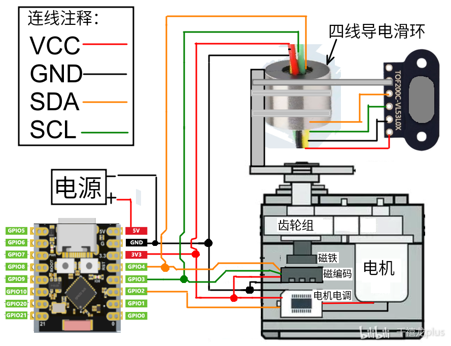

# Electro-Dragon Drill: 1D Rotating LiDAR Scanner
> Project Introduction: Electro-Dragon Drill is a continuous rotating one-dimensional laser scanning radar based on ESP32-C3 Super Mini. A 6.5mm 4-channel slip ring is adopted to avoid wire tangling for the rotating TOF sensor. An AS5600 magnetic encoder measures the shaft angle, and a first-order Fourier harmonic fitting algorithm compensates angle error caused by magnet eccentricity. The VL53L0X TOF ranging module rotates synchronously with the scanning head, samples angle-distance pairs and outputs polar point clouds for 2D contour plotting on a host computer.
>

## Hardware List
| Component | Specification | Description |
| ---- | ---- | -------- |
| MCU | ESP32-C3 Super Mini | Main controller, I2C sensor reading, PWM servo driving, data output |
| Slip Ring | 6.5mm, 4 channels | Rotates with scanning head, transmits 3.3V power and I2C signals for VL53L0X, prevents cable twisting |
| Rotation Driver | 360° continuous rotation SG90 servo with gear reduction set | Drives slip ring rotor and VL53L0X scanning head for circular sweep |
| Angle Sensor | AS5600 Magnetic Encoder | Mounted statically at the bottom of servo shaft, reads absolute rotation angle over I2C, **not routed through slip ring** |
| Ranging Sensor | VL53L0X (TOF200C) | Mounted on slip ring rotor, rotates together, measures target distance, signals pass through slip ring |

## Mechanical Assembly Sequence (Reference Schematic)
> Core assembly rule: **AS5600 is stationary; VL53L0X + slip ring rotor are rotating parts**
1. **Bottom Layer: AS5600 Magnetic Encoder Installation**
Attach the magnet to the bottom end of the SG90 output shaft. Fix the AS5600 PCB on the stationary base of the servo. Align the magnet to the center of the AS5600 chip with a gap of 1~3 mm.
⚠️ Important: The AS5600 assembly stays static. Its wires connect directly to ESP32 and **do not go through the slip ring**.

2. **Middle Layer: SG90 Servo Mounting**
Secure the SG90 servo to the bracket. Keep the output shaft vertical. Fasten the gear set tightly to eliminate backlash and slipping.

3. **Upper Layer: 4-Channel Slip Ring Installation**
Lock the slip ring rotor (rotating side) rigidly to the SG90 output shaft for synchronous rotation. Fix the slip ring stator (outer ring) to the stationary support.
Channel allocation for the slip ring: 3V3, GND, SDA, SCL, dedicated for VL53L0X.

4. **Top Layer: VL53L0X Ranging Module Mounting**
Fix VL53L0X onto the slip ring rotor so it rotates together. Route the four wires of VL53L0X to the rotor side of the slip ring. Signals are transferred through the slip ring to the stator and then to the ESP32 I2C bus.

5. **Cable Management**
Only VL53L0X cables are routed into the slip ring rotor (rotating side).
Stationary side wiring includes: slip ring stator output, AS5600 encoder wires, SG90 servo PWM control line.
Separate power cables from I2C signal cables to reduce EMI from servo switching.

## Wiring Definition (Matches Schematic, Shared I2C Bus)
Shared I2C Bus (I2C0):
- I2C SDA → ESP32-C3 GPIO4 (Orange)
- I2C SCL → ESP32-C3 GPIO3 (Green)

### 1. VL53L0X (TOF200C, routed through 4-channel slip ring)
- Red VCC: 3.3V (**DO NOT connect to 5V, will burn the sensor**)
- Black GND: Common ground
- Yellow SDA: I2C Data
- Green SCL: I2C Clock

### 2. AS5600 Magnetic Encoder (Direct wiring to MCU, bypass slip ring)
- Red VCC: 3.3V
- Black GND: Common ground
- SDA: I2C Data (GPIO4)
- SCL: I2C Clock (GPIO3)

> Address Note: AS5600 I2C address `0x36`, VL53L0X I2C address `0x29`. No conflict, can coexist on the same I2C bus.

### 3. 360° Continuous Rotation SG90 Servo
- VCC (+): Independent 5V supply. Do not draw large current from ESP32 onboard power.
- GND (-): Power negative. **Must share a common ground with ESP32, AS5600 and VL53L0X**.
- SIG: ESP32-C3 GPIO2, 50Hz PWM signal for direction and speed control.

### 4. Power System
- Power supply for servo: 5V output for SG90
- 3.3V supply: For VL53L0X and AS5600, can use ESP32-C3 onboard 3V3 pin
- Common ground is critical: All GND nodes must be connected together, otherwise I2C corruption and read failures frequently occur.

## Working Principle
1. ESP32-C3 outputs a 50Hz PWM signal on GPIO2 to drive the continuous-rotation SG90 servo at constant speed.
2. Servo shaft spins the slip ring rotor and VL53L0X scanning head synchronously.
3. The statically installed AS5600 encoder reads raw shaft angle. A built-in **first-order Fourier harmonic correction** compensates periodic angle error introduced by magnet and mounting eccentricity, and outputs calibrated true angle.
4. VL53L0X continuously measures obstacle distance. Ranging data is transmitted through the slip ring to the ESP32.
5. The MCU samples paired data: calibrated angle (θ) + range (r), forming polar coordinate points.
6. Data is printed over UART, can be saved to on-board text file or captured by host computer. Matplotlib can be used to render 2D scanning contour, implementing a simple LiDAR.

## Assembly & Debug Checklist
✅ Mechanical Check
- Slip ring stator fixed firmly; rotor rotates smoothly without jamming
- VL53L0X securely attached and rotates synchronously with rotor
- AS5600 magnet well centered with proper gap, no scraping against PCB
- No cable twisting during servo rotation (the core purpose of the slip ring)

✅ Wiring Check
- Confirm VL53L0X runs on 3.3V, avoid accidental 5V connection
- All GND points interconnected
- SDA / SCL not swapped
- AS5600 wired directly to MCU, not to slip ring rotor

✅ Power-up Debug Sequence (Recommended)
1. Disconnect servo 5V power first, power only ESP32 and sensors.
2. Flash firmware, monitor serial log. Verify stable readings from AS5600 and VL53L0X without persistent I2C errors.
3. After sensor communication is stable, connect servo 5V power.
4. Start servo rotation, verify angle output is smooth without abrupt jumps.
5. Zero calibration: Select a fixed mechanical reference direction and define it as 0°.
6. Validate harmonic correction: Rotate shaft slowly by hand, confirm calibrated angle changes uniformly with no periodic bias.

✅ Troubleshooting
1. Frequent I2C errors: Poor common ground, high slip ring contact resistance, long I2C traces, servo EMI. Add 0.1μF capacitor across sensor power pins.
2. Periodic angle deviation: Magnet eccentricity, which is the exact problem solved by the harmonic correction function.
3. Intermittent range loss: Poor slip ring quality, unstable transmission for high-speed I2C signals.
4. Servo stalls / abnormal speed: Insufficient 5V supply current. Continuous rotation SG90 draws larger startup current than positional servos.
