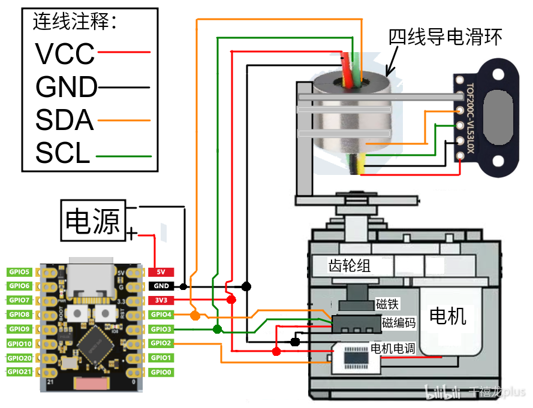

# 电光独龙钻｜一维旋转激光扫描雷达
> 项目简介：电光独龙钻是一套基于ESP32-C3 Super Mini主控搭建的连续旋转一维激光扫描雷达。使用6.5mm四线导电滑环解决旋转端传感器线束缠绕问题，搭配AS5600磁编码器获取转轴角度，通过一阶傅里叶谐波拟合补偿磁铁偏心误差；VL53L0X激光测距模块跟随扫描头同步旋转，同步采集角度+距离，输出极坐标点云，可在上位机绘制二维扫描轮廓。

## 一、硬件清单
| 器件 | 规格 | 功能说明 |
| ---- | ---- | -------- |
| 主控 | ESP32-C3 Super Mini | 系统主控，I2C读取传感器、PWM驱动舵机、数据上报 |
| 导电滑环 | 6.5mm 四线滑环 | 转子随扫描头旋转，传递VL53L0X供电与I2C信号，防线束缠绕 |
| 扫描驱动 | 360°连续旋转SG90舵机（带齿轮减速组） | 带动滑环转子+VL53L0X扫描头圆周旋转 |
| 角度采集 | AS5600磁编码器 | 安装于SG90主轴底部，I2C读取扫描头绝对旋转角度，静止安装不走滑环 |
| 测距传感器 | VL53L0X（TOF200C） | 固定在滑环转子侧，同步旋转，测量目标距离，信号经过滑环传输 |

## 二、机械装配顺序（对照原理图组装）
> 装配核心逻辑区分：**AS5600为静止部件；VL53L0X+滑环转子为旋转部件**
1. **底层：AS5600磁编码器装配**
磁铁固定在SG90舵机主轴底端；AS5600电路板固定在舵机静止底座外壳上，磁铁正对AS5600芯片中心，间隙控制1~3mm。
⚠️ 重点：AS5600整套静止，信号线**不经过滑环**，直接接线到ESP32主控。

2. **中层：SG90舵机固定**
将SG90舵机固定在支架上，保证主轴垂直向上，锁紧齿轮组，消除传动旷量、打滑。

3. **上层：四线导电滑环安装**
滑环转子（旋转端）和SG90输出主轴刚性锁紧，同步转动；滑环定子（外圈）固定在静止支架上，保持不动。
滑环四路通道分配：3V3、GND、SDA、SCL，专门供给VL53L0X使用。

4. **顶端：VL53L0X测距模块固定**
VL53L0X固定在滑环转子上，跟随转子同步旋转；VL53L0X四根线接入滑环转子端，信号经由滑环转接至定子，再引出到ESP32的I2C总线。

5. **线束整理**
旋转侧仅保留VL53L0X的线路，全部接入滑环转子；
固定侧包含：滑环定子出线、AS5600编码器出线、SG90舵机PWM控制线；
动力电源线与I2C信号线分开走线，减少舵机启停带来的电磁干扰。

## 三、硬件接线定义（和原理图一一对应，共用一组I2C总线）
共用I2C总线（I2C0）：
- I2C SDA → ESP32-C3 GPIO4（橙线）
- I2C SCL → ESP32-C3 GPIO3（绿线）

### 1. VL53L0X（TOF200C，线路经过四线滑环）
- 红线 VCC：3.3V（禁止接入5V，会烧毁传感器）
- 黑线 GND：公共地
- 黄线 SDA：I2C数据
- 绿线 SCL：I2C时钟

### 2. AS5600 磁编码器（直接连接主控，不走滑环）
- 红线 VCC：3.3V
- 黑线 GND：公共地
- SDA：I2C数据（GPIO4）
- SCL：I2C时钟（GPIO3）

> 地址说明：AS5600 I2C地址`0x36`，VL53L0X I2C地址`0x29`，地址互不冲突，可以挂载在同一条I2C总线。

### 3. 360°连续旋转SG90舵机
- VCC（+）：独立5V供电，不要直接使用ESP32板载电源驱动
- GND（-）：电源负极，**必须和ESP32、AS5600、VL53L0X全部共地**
- SIG信号线：ESP32-C3 GPIO2，50Hz PWM信号，控制转向与转速

### 4. 电源系统
- 动力电源：输出5V，给SG90舵机供电
- 3.3V电源：给VL53L0X、AS5600供电，可由ESP32-C3的3V3引脚输出
- 共地是重中之重：所有模块的GND必须连通，否则I2C容易乱码、频繁读取出错

## 四、系统工作原理
1. ESP32-C3在GPIO2输出50Hz PWM信号，驱动360° SG90舵机匀速持续旋转；
2. 舵机主轴同步带动导电滑环转子与VL53L0X激光扫描头一起圆周转动；
3. 底部静止安装的AS5600磁编码器实时读取主轴原始角度；程序内置**一阶傅里叶谐波校正算法**，补偿安装偏心、磁铁偏心带来的角度误差，输出校正后的真实角度；
4. VL53L0X持续测量前方障碍物距离，测距信号通过导电滑环稳定传输到ESP32主控；
5. 主控同步采集一组数据：校正角度(θ) + 距离(r)，构成极坐标采样点；
6. 数据通过串口打印输出，可保存至板载txt文件，或者由上位机接收，使用Matplotlib绘制二维平面扫描轮廓，实现简易激光雷达扫描。

## 五、装配上电调试检查清单
✅ 机械检查项
- 滑环定子固定牢固，转子转动顺滑无卡滞
- VL53L0X固定牢靠，和滑环转子同步转动，无松动
- AS5600磁铁对中良好，间隙合适，磁铁不会刮蹭编码器电路板
- 舵机旋转全程没有线束绞缠（滑环的作用就是解决绞线问题）

✅ 接线检查项
- VL53L0X供电确认是3.3V，杜绝误接5V
- 所有GND全部连通共地
- SDA、SCL没有接反
- AS5600线路直接连主控，没有接到滑环转子侧

✅ 上电调试顺序（严格推荐）
1. 先断开舵机5V供电，只给ESP32、两个传感器上电；
2. 烧录程序，观察串口日志，确认可以稳定读取AS5600角度、VL53L0X距离，无持续I2C报错；
3. 传感器通信正常后，再接通舵机5V电源；
4. 舵机启动旋转，观察角度输出平滑连续，无异常跳变；
5. 机械零点校准：选定一个固定基准方向，定义为扫描0°；
6. 谐波校正效果验证：手动缓慢转动转轴，观察校正后的角度均匀变化，无周期性偏差。

✅ 常见故障排查
1. I2C频繁报错：共地不良、滑环接触电阻大、I2C走线过长、舵机电磁干扰；可在传感器电源引脚增加0.1μF（104）去耦电容；
2. 角度周期性偏差：磁铁偏心问题，正是本程序谐波校正模块解决的目标；
3. 测距值偶尔丢失：滑环品质较差，I2C高速信号传输不稳定；
4. 舵机不转/转速异常：5V电源输出电流不足，连续旋转SG90启动电流大于普通角度舵机。
